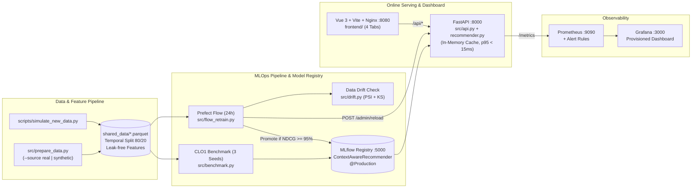

# Context-Aware E-commerce Recommender (MLOps)

[](.github/workflows/ci.yml)


Hệ thống **Khuyến nghị Sản phẩm Thương mại Điện tử theo Ngữ cảnh Người dùng (Context-Aware E-Commerce Recommender)** tích hợp quy trình **MLOps End-to-End** — Dự án cuối khóa học phần *Phát triển các hệ thống thông minh (INT14151)*.

---

## 1. Kiến trúc Hệ thống (CLO2)



---

## 2. Cấu trúc Thư mục

```text
context-recsys-ai/
├── .github/workflows/ci.yml        # GitHub Actions: ruff, pytest+cov, docker smoke test, GHCR publish
├── docs/
│   ├── ARCHITECTURE.md             # Kiến trúc chi tiết & lý do chọn công nghệ (CLO2)
│   ├── DATA.md                     # Đặc tả Data Contract, chống leakage & phân tích EDA
│   ├── DECISIONS.md                # Nhật ký quyết định kỹ thuật (ADR)
│   ├── figures/                    # Biểu đồ tự động: EDA, so sánh mô hình, NCF learning curve, feature importance
│   ├── results/                    # Số liệu tự động: benchmark_results.{csv,md}, latency.md, drift_report.html
│   └── screenshots/                # Ảnh chụp giao diện Dashboard, MLflow, Prefect, Grafana
├── frontend/                       # Ứng dụng Vue 3 + Vite + Nginx (multi-stage Dockerfile riêng)
│   ├── Dockerfile
│   ├── nginx.conf
│   ├── package.json
│   └── src/                        # Giao diện 4 tab tiếng Việt + Dark Mode + So sánh 2 ngữ cảnh
├── monitoring/
│   ├── prometheus.yml              # Cấu hình scrape /metrics
│   ├── alert_rules.yml             # Cảnh báo SLA độ trễ p95 > 100ms & tỉ lệ lỗi
│   └── grafana/provisioning/       # Tự động cấu hình Datasource & Dashboard MLOps
├── scripts/
│   ├── load_test.py                # Đo kiểm độ trễ p50/p95/p99 & RPS -> docs/results/latency.md
│   ├── simulate_new_data.py        # Mô phỏng tương tác mới (kèm tùy chọn --drift)
│   ├── smoke_test.py               # Kiểm thử tích hợp toàn tuyến
│   ├── trigger_retrain.sh          # Kích hoạt nhanh Prefect retrain + hot-reload API
│   └── generate_ui_screenshots.py  # Xuất ảnh chụp kết quả trực quan vào docs/screenshots/
├── src/
│   ├── models.py                   # 6 kiến trúc mô hình PyFunc (Popularity, CBF, MF-SVD, LightGBM, XGBoost, NCF)
│   ├── prepare_data.py             # Chuẩn bị dữ liệu (--source real|synthetic), temporal split 80/20, EDA
│   ├── metrics.py                  # Precision@10, Recall@10, NDCG@10, MAP@10, ROC-AUC, Latency/query
│   ├── benchmark.py                # Benchmark 6 mô hình + Ablation qua 3 seeds, đăng ký @Production
│   ├── drift.py                    # Kiểm định Data Drift (PSI + KS-Test) -> docs/results/drift_report.html
│   ├── flow_retrain.py             # Prefect flow 5 task (Validate -> Feature -> Drift -> Train -> Promote)
│   ├── recommender.py              # In-memory feature vectorization, cold-start fallback, auto-reload
│   └── api.py                      # FastAPI service (/recommend, /health, /model/info, /admin/reload, /metrics...)
├── tests/
│   ├── test_api.py                 # Kiểm thử API endpoints, validation, cold-start, hot-reload
│   └── test_pipeline.py            # Kiểm thử toán học metrics, data contract, chống data leakage, drift
├── Dockerfile                      # Container backend / MLflow / Prefect
├── docker-compose.yml              # Khởi chạy toàn bộ 6 dịch vụ bằng 1 lệnh
├── Makefile                        # Các lệnh tắt: make data, make benchmark, make up, make test...
├── requirements.docker.txt         # Thư viện runtime gọn nhẹ
└── requirements-dev.txt            # Thư viện kiểm thử & lint (pytest, pytest-cov, ruff, pre-commit)
```

---

## 3. Hướng dẫn Chạy Nhanh (Quick Start)

### 3.1. Khởi chạy toàn bộ hệ thống bằng 1 lệnh Docker Compose
```bash
# Bước 1: Sinh dữ liệu & biểu đồ EDA (hoặc để container tự sinh khi khởi động)
make data

# Bước 2: Dựng toàn bộ 6 dịch vụ (MLflow, FastAPI, Prefect, Vue Frontend, Prometheus, Grafana)
make up
# Hoặc: docker compose up -d --build

# Bước 3: Huấn luyện, so sánh các mô hình CLO1 (3 seeds) & đăng ký model @Production
make benchmark
```

### 3.2. Danh sách URL các Dịch vụ
| Dịch vụ | Địa chỉ URL | Mô tả |
|---|---|---|
| **Vue 3 Web Dashboard** | `http://localhost:8080` | Giao diện 4 tab: Gợi ý & So sánh ngữ cảnh, Giao dịch, Phân tích, Mô hình |
| **FastAPI Backend & Docs** | `http://localhost:8000/docs` | REST API (`/recommend`, `/model/info`, `/admin/reload`, `/metrics`) |
| **MLflow Tracking & Registry** | `http://localhost:5000` | Quản lý runs, so sánh tham số/metrics và Model Registry (`@Production`) |
| **Prometheus** | `http://localhost:9090` | Truy vấn time-series metrics và trạng thái SLA Alerts |
| **Grafana Dashboard** | `http://localhost:3000` | Dashboard MLOps được provision sẵn (`admin` / `admin`) |

---

## 4. Các Lệnh Vận hành MLOps (Benchmark, Drift, Retrain, Test)

```bash
# 1. Truy vấn thử API gợi ý theo ngữ cảnh (Mobile 20h vs Desktop 10h)
curl -X POST http://localhost:8000/recommend \
  -H "Content-Type: application/json" \
  -d '{"user_id":15,"device":"mobile","hour":20,"top_k":10}'

# 2. Mô phỏng dữ liệu mới có Data Drift & kiểm tra báo cáo Drift
python scripts/simulate_new_data.py --rows 2000 --drift
make drift

# 3. Kích hoạt Prefect Retraining Pipeline & tự động Hot-Reload model trên API
bash scripts/trigger_retrain.sh

# 4. Đo kiểm độ trễ suy luận (p50 / p95 / p99) -> docs/results/latency.md
make load-test

# 5. Chạy bộ kiểm thử tự động & kiểm tra mã nguồn (Pytest + Ruff)
make lint
make test
```

---

## 5. Danh mục File Kết quả Sinh Tự động (Dùng cho Báo cáo Kỹ thuật)
- **Bảng kết quả so sánh mô hình (Mean ± Std qua 3 seeds & Ablation)**:
  - [docs/results/benchmark_results.md](file:///c:/Users/BaDuy/Downloads/recsys-additions/docs/results/benchmark_results.md)
  - [docs/results/benchmark_results.csv](file:///c:/Users/BaDuy/Downloads/recsys-additions/docs/results/benchmark_results.csv)
- **Báo cáo đo kiểm độ trễ API (`p50`, `p95`, `p99`, `RPS`)**:
  - [docs/results/latency.md](file:///c:/Users/BaDuy/Downloads/recsys-additions/docs/results/latency.md)
- **Báo cáo kiểm định Data Drift (PSI & KS-test)**:
  - [docs/results/drift_report.html](file:///c:/Users/BaDuy/Downloads/recsys-additions/docs/results/drift_report.html)
- **Biểu đồ EDA & Thực nghiệm (`docs/figures/`)**:
  - [docs/figures/eda_distributions.png](file:///c:/Users/BaDuy/Downloads/recsys-additions/docs/figures/eda_distributions.png)
  - [docs/figures/eda_context_heatmap.png](file:///c:/Users/BaDuy/Downloads/recsys-additions/docs/figures/eda_context_heatmap.png)
  - [docs/figures/eda_long_tail.png](file:///c:/Users/BaDuy/Downloads/recsys-additions/docs/figures/eda_long_tail.png)
  - [docs/figures/model_comparison.png](file:///c:/Users/BaDuy/Downloads/recsys-additions/docs/figures/model_comparison.png)
  - [docs/figures/ncf_learning_curve.png](file:///c:/Users/BaDuy/Downloads/recsys-additions/docs/figures/ncf_learning_curve.png)
  - [docs/figures/feature_importance.png](file:///c:/Users/BaDuy/Downloads/recsys-additions/docs/figures/feature_importance.png)
- **Ảnh chụp Giao diện Hệ thống (`docs/screenshots/`)**:
  - [docs/screenshots/dashboard_recommend.png](file:///c:/Users/BaDuy/Downloads/recsys-additions/docs/screenshots/dashboard_recommend.png)
  - [docs/screenshots/mlflow_runs_registry.png](file:///c:/Users/BaDuy/Downloads/recsys-additions/docs/screenshots/mlflow_runs_registry.png)
  - [docs/screenshots/prefect_retrain_flow.png](file:///c:/Users/BaDuy/Downloads/recsys-additions/docs/screenshots/prefect_retrain_flow.png)
  - [docs/screenshots/grafana_monitoring.png](file:///c:/Users/BaDuy/Downloads/recsys-additions/docs/screenshots/grafana_monitoring.png)
