# Kiến trúc Hệ thống MLOps — Context-Aware Recommender (CLO2)

## 1. Sơ đồ Kiến trúc Tổng thể

```mermaid
flowchart LR
    subgraph DataLayer["1. Data & Feature Layer"]
        Raw["prepare_data.py<br/>(Real / Synthetic Source)"] --> Parquet[("shared_data/*.parquet<br/>interactions, products,<br/>train, test, features")]
        Sim["simulate_new_data.py<br/>(Incoming Stream / Drift)"] --> Parquet
    end

    subgraph Orchestration["2. MLOps Pipeline (Prefect)"]
        Parquet --> Ingest["Task 1: Validate Contract"]
        Ingest --> FeatEng["Task 2: Leak-free Features"]
        FeatEng --> Drift["Task 3: PSI & KS Drift Check<br/>(drift_report.html)"]
        Drift --> Retrain["Task 4: Train & Evaluate<br/>(LightGBM / Benchmark)"]
        Retrain --> Gate["Task 5: Promotion Gate<br/>(NDCG@10 >= 95% Prod)"]
    end

    subgraph Registry["3. Experiment & Model Registry"]
        Bench["benchmark.py<br/>(6 Models + Ablation, 3 Seeds)"] --> MLflow[("MLflow Server :5000<br/>SQLite + Artifact Store<br/>@Production Alias")]
        Gate --> MLflow
    end

    subgraph Serving["4. Online Serving & UI"]
        MLflow -->|"Load @Production + Auto-Reload"| API["FastAPI Service :8000<br/>In-Memory Feature Cache<br/>Cold-Start Fallback"]
        Gate -->|"POST /admin/reload"| API
        FE["Vue 3 + Vite + Nginx :8080<br/>4-Tab Real-time Dashboard"] -->|"/api/* Reverse Proxy"| API
    end

    subgraph Observability["5. Monitoring & Alerting"]
        API -->|"/metrics"| Prom["Prometheus :9090<br/>+ SLA Alert Rules"]
        Prom --> Graf["Grafana :3000<br/>Provisioned MLOps Dashboard"]
    end
```

---

## 2. Mô tả Chi tiết Từng Thành phần & Lý do Lựa chọn Công nghệ

| Thành phần | Công nghệ sử dụng | Vai trò & Lý do lựa chọn |
|---|---|---|
| **Data & Feature Store** | Apache Parquet (`pyarrow`) + `pandas`/`numpy` | Lưu trữ dạng cột (columnar) tốc độ đọc/ghi cao gấp 5–10 lần CSV, bảo toàn kiểu dữ liệu schema nghiêm ngặt và dùng chung dễ dàng qua Docker volume `shared_data/`. |
| **Model Training & CLO1 Benchmark** | `scikit-learn` (TF-IDF, TruncatedSVD), `LightGBM`, `XGBoost`, `PyTorch` (CPU NCF) | Bao phủ đầy đủ các họ thuật toán gợi ý: Baseline phổ biến, Content-Based, Collaborative Filtering (Matrix Factorization), Gradient Boosted Trees có ngữ cảnh (LightGBM, XGBoost), và Deep Learning (Context-Aware Neural Collaborative Filtering). |
| **Experiment Tracking & Model Registry** | **MLflow** (`v2.22+`) | Quản lý toàn bộ siêu tham số, metrics (`NDCG@10`, `MAP@10`, `Recall@10`, `Precision@10`, `AUC`, `latency`), biểu đồ Feature Importance, và đóng gói model qua `mlflow.pyfunc` kèm `code_paths=["src/models.py"]` cùng alias `@Production`. |
| **Workflow Orchestration** | **Prefect 3** (`src/flow_retrain.py`) | Nhẹ hơn Apache Airflow khi chạy trong Docker Compose trên 1 máy CPU, hỗ trợ đầy đủ `@flow`, `@task`, retry tự động, lập lịch 24h (`--serve`) và tích hợp cổng kiểm duyệt (Promotion Gate: chỉ promote khi `NDCG@10 >= 95%` bản `@Production` hiện hành). |
| **Data Drift Detection** | **PSI + KS-Test** (`src/drift.py`) | Tính toán chỉ số ổn định quần thể (Population Stability Index - PSI) và kiểm định phi tham số Kolmogorov-Smirnov trên `hour`, `is_mobile`, `category`; xuất báo cáo trực quan độc lập `docs/results/drift_report.html` không phụ thuộc dịch vụ đám mây bên ngoài. |
| **Real-time Serving Backend** | **FastAPI + Uvicorn** (`src/api.py`, `src/recommender.py`) | Bất đồng bộ, tự động sinh OpenAPI `/docs`, kiểm tra hợp lệ dữ liệu vào bằng Pydantic v2. Đặc biệt, `RecommenderService` tiền xử lý toàn bộ vector sản phẩm và ngữ cảnh trong RAM giúp độ trễ suy luận `p95 < 15 ms` (vượt xa mục tiêu `< 100 ms`). |
| **Interactive Frontend** | **Vue 3 + Vite + Nginx** (`frontend/`) | Đóng gói multi-stage Docker container riêng biệt (cổng `8080`), giao diện 4 tab tiếng Việt hỗ trợ Dark Mode, cho phép so sánh trực quan kết quả gợi ý giữa 2 ngữ cảnh cạnh nhau (ví dụ `Mobile 20h` vs `Desktop 10h`). |
| **Observability & Monitoring** | **Prometheus + Grafana** (`monitoring/`) | Thu thập time-series metrics từ `/metrics` (lưu lượng theo thiết bị, phân phối độ trễ `p50/p95/p99`, tỉ lệ lỗi, phiên bản model `@Production`, điểm số gợi ý) và hiển thị tự động trên Grafana dashboard đã provision sẵn. |
